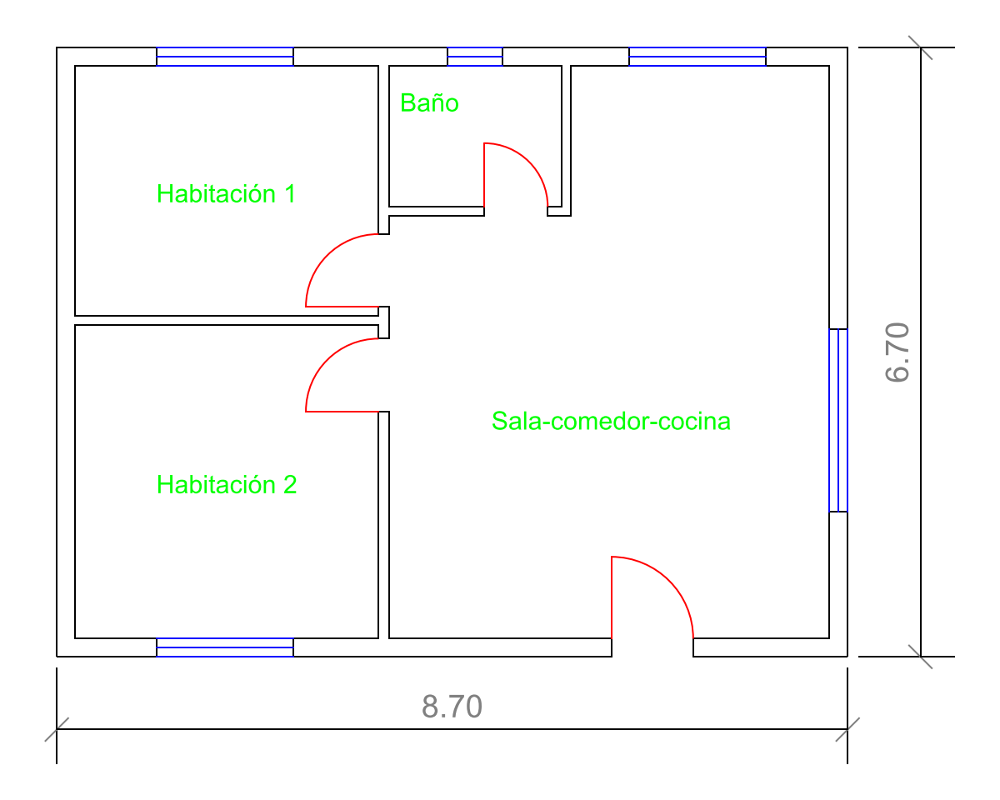
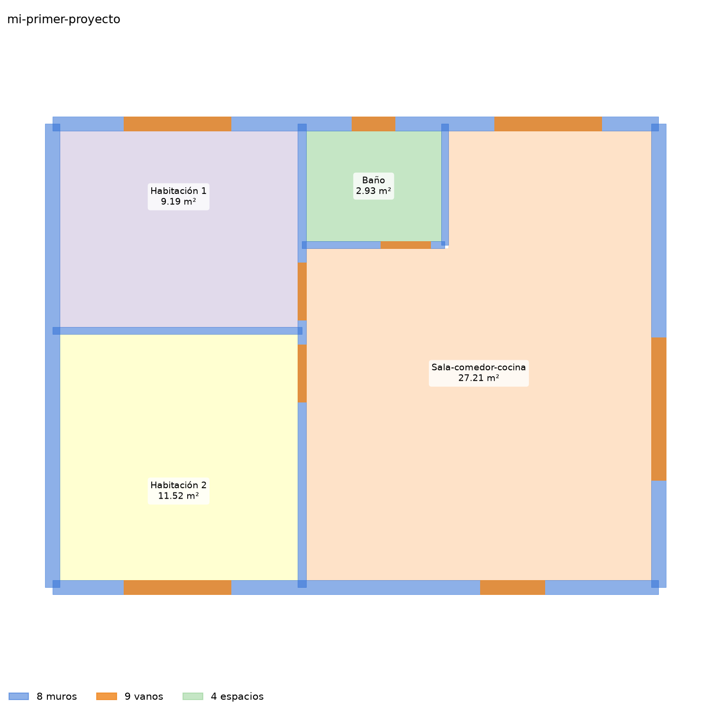

# ArchiMind

ArchiMind convierte tus planos de AutoCAD (DXF o DWG) en un modelo que Claude entiende: muros,
puertas, ventanas y espacios, con sus medidas. Desde ahí le pides, hablando normal, el cuadro de
áreas, el plano limpio, la carpintería, un modelo 3D para Rhino, cortes, axonometrías o la
memoria del proyecto en PDF.

Funciona dentro de **Claude Desktop**, la aplicación de escritorio de Claude: no tiene ventanas
propias. Tú escribes en el chat; Claude usa las herramientas de ArchiMind y te muestra el
resultado.

| Tu plano (DXF) | Lo que entiende ArchiMind |
|---|---|
|  |  |

## Qué le puedes pedir

| Para… | Escríbele a Claude, por ejemplo |
|---|---|
| Empezar un proyecto | «Abre el proyecto en C:\Users\Ana\Documents\ArchiMind-proyectos\casa-lopez e importa el plano C:\Users\Ana\Desktop\planta.dxf» |
| Que entienda el plano | «Propón qué es cada capa» y luego «Aplícalo tal cual» |
| Ver lo que entendió | «Muéstrame la planta en una imagen» |
| Las superficies | «Dame el cuadro de áreas» |
| Un plano limpio para CAD | «Exporta el plano en DXF» (o «en DWG») |
| El 3D | «La altura de piso a techo es 2.60 m» y luego «Exporta el modelo 3D» |
| Puertas y ventanas | «Pon la carpintería en el plano» · «Hazme una ventana corrediza de aluminio de 3 hojas de 2.40 × 1.50» |
| Documentos | «Calcula el COS y el CUS con un lote de 120 m²» · «Haz el presupuesto preliminar» · «Redacta la memoria y genera la ficha en PDF» |
| Rhino | «Abre el proyecto en Rhino» · «Haz una axonometría desde el suroeste» · «Propón cortes» |

Lo explica todo, paso a paso y con ejemplos, la **[guía de uso](docs/guia-de-uso.md)**.

## Qué hace falta

- Un equipo con **Windows 10 u 11** y conexión a internet.
- **Claude Desktop** con tu cuenta de Claude.
- Opcional: **Rhino 8**, para editar el modelo en 3D y dibujar axonometrías y cortes; **ODA File
  Converter**, solo si vas a abrir o entregar planos en DWG (con DXF no hace falta).

## Instalación (unos 10 minutos, una sola vez)

1. **Instala Claude Desktop** desde <https://claude.ai/download>, ábrelo y entra con tu cuenta.
2. **Descarga ArchiMind**: en <https://github.com/samcastroca/ArchiMind> (no hace falta cuenta
   de GitHub), botón verde **Code** → **Download ZIP**. Abre el ZIP (queda en Descargas), pulsa **Extraer todo** y elige una carpeta
   fácil, por ejemplo `C:\ArchiMind`.
3. **Haz doble clic en `Instalar ArchiMind`**, dentro de la carpeta extraída (junto a este
   `README`). Se abre una ventana negra que instala lo que falte y conecta ArchiMind con Claude
   Desktop. Puede pasar:
   - **Windows protegió su PC**: pulsa **Más información** → **Ejecutar de todas formas**.
     Aparece porque el archivo viene de internet.
   - **¿Permitir que esta aplicación haga cambios?**: es el instalador de Git; pulsa **Sí**.

   Al final, la ventana dice **Listo** y te muestra la frase exacta para tu primera prueba. Si
   alguna línea dice **[FALTA]**, explica qué hacer.
4. **Cierra Claude Desktop del todo y ábrelo de nuevo.** Cerrar la ventana no basta: busca su
   icono junto al reloj (a veces detrás de la flecha `^`), clic derecho → **Salir**.

Para comprobarlo, en Claude Desktop: **Configuración → Desarrollador**. Deben aparecer
`archimind-core`, `archimind-bloques` y `archimind-docs` (y `rhino-bridge`, si tienes Rhino 8),
en marcha.

## Tu primer proyecto (5 minutos)

El instalador deja un plano de ejemplo en `Documentos\ArchiMind-proyectos`. En un chat nuevo de
Claude Desktop, pega la frase que te dio el instalador. Es como esta, con tu usuario:

> Abre el proyecto en C:\Users\Ana\Documents\ArchiMind-proyectos\mi-primer-proyecto e importa el
> plano C:\Users\Ana\Documents\ArchiMind-proyectos\ejemplo-apartamento.dxf

Claude pide permiso para usar las herramientas de ArchiMind: pulsa **Permitir**. Luego, paso a
paso:

1. Claude crea la carpeta del proyecto, copia el plano y te cuenta lo que tiene: 5 capas
   (`A-MURO`, `A-PUERTA`, `A-VENTANA`, `A-TEXTO`, `A-COTA`) y que está en metros.
2. Escribe **«Propón qué es cada capa»**. Responde, capa por capa, qué cree que es y por qué:
   «A-MURO → muros: el nombre contiene MURO y hay 24 pares de tramos paralelos…».
3. Escribe **«Aplícalo tal cual»**. ArchiMind reconstruye el modelo: *1 nivel, 8 muros, 9
   vanos, 4 espacios*.
4. Escribe **«Muéstrame la planta»**. Guarda la imagen de arriba a la derecha en
   `salidas\vista.png`, dentro de la carpeta del proyecto.
5. Escribe **«Dame el cuadro de áreas»**:

   ```
   Baño (útil): 2.93 m²
   Habitación 1 (útil): 9.19 m²
   Sala-comedor-cocina (útil): 27.21 m²
   Habitación 2 (útil): 11.52 m²
   Área útil: 50.85 m² · Área construida: 58.29 m² · Balcones: 0.00 m²
   ```

   y lo deja también en `salidas\cuadro_de_areas.csv`, que se abre con Excel.

Con tus propios planos es igual: cambia las rutas por las tuyas. Para copiar la ruta de un
archivo: clic derecho sobre él en el Explorador → **Copiar como ruta de acceso** (en Windows 10,
manteniendo pulsada la tecla Mayúsculas al hacer clic derecho).

## Tres cosas que conviene saber

- **Las cifras las calcula ArchiMind, no Claude.** Claude redacta y explica, pero cada área,
  longitud o precio sale del modelo o de tu base de datos.
- **«PRELIMINAR»** quiere decir que la escala del plano aún no está confirmada: las cantidades
  pueden cambiar. Si el plano no dice en qué unidades está, ArchiMind las deduce y te pide que las
  confirmes («Sí, está en milímetros») o que le des una medida real («ese muro mide 4.20 m»).
- **Cada cambio queda guardado como una versión**, y se pueden comparar («¿Qué cambió desde la
  versión anterior?»). Guarda los proyectos fuera de la carpeta de ArchiMind (el instalador ya
  crea `Documentos\ArchiMind-proyectos`): así, al actualizar ArchiMind, no se tocan.

## Actualizar ArchiMind

Descarga el ZIP nuevo (paso 2), reemplaza la carpeta de ArchiMind por la nueva, haz doble clic
otra vez en **Instalar ArchiMind** y reinicia Claude Desktop (paso 4). Tus proyectos y tus
datos no se tocan, y si pusiste la carpeta en otro sitio, el instalador corrige la configuración
solo. Si añadiste perfiles al catálogo de carpintería, antes copia
`packages\bloques\catalog.yaml` de la carpeta vieja a la nueva.

## Si algo falla

- **ArchiMind no aparece en Claude Desktop**: ciérralo del todo desde el icono junto al reloj
  (**Salir**) y ábrelo. Si sigue sin aparecer, vuelve a ejecutar **Instalar ArchiMind**.
- **El instalador muestra [FALTA]**: la misma línea dice qué hacer. Lo ocurrido queda en
  `instalacion.log`, en la carpeta de ArchiMind; envíaselo a quien te ayude.
- **Un plano DWG no se abre**: hace falta ODA File Converter o exportar el plano a DXF desde
  AutoCAD (Guardar como → DXF).

Más casos en **[problemas frecuentes](docs/problemas-frecuentes.md)**.

## Más documentación

- [Guía de uso](docs/guia-de-uso.md): cada tarea con ejemplos, de importar a la ficha PDF.
- [Rhino 8](docs/rhino.md): editar el modelo en Rhino, axonometrías y cortes.
- [Problemas frecuentes](docs/problemas-frecuentes.md).
- [Instalación manual](docs/instalacion-manual.md): lo que hace el instalador, paso a paso, y la
  configuración de Claude Desktop a mano.
- [Base de datos de precios, materiales y programa](packages/docs/README.md): las columnas de cada
  tabla.
- [Referencia técnica](docs/referencia-tecnica.md): cada servidor y herramienta en detalle.

## Para desarrolladores

Es un workspace de [uv](https://docs.astral.sh/uv/) con Python ≥ 3.11: `uv sync` lo instala,
`uv run pytest` corre las pruebas y `uv run ruff check . && uv run mypy packages
bridges/rhino/mcp` revisa estilo y tipos. La arquitectura, las reglas y los comandos están en
[CLAUDE.md](CLAUDE.md); el estado de cada paquete, en la [referencia
técnica](docs/referencia-tecnica.md#estado).
